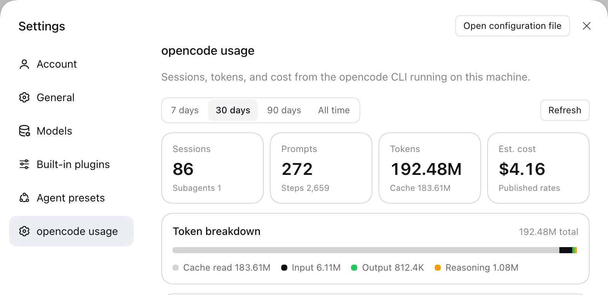
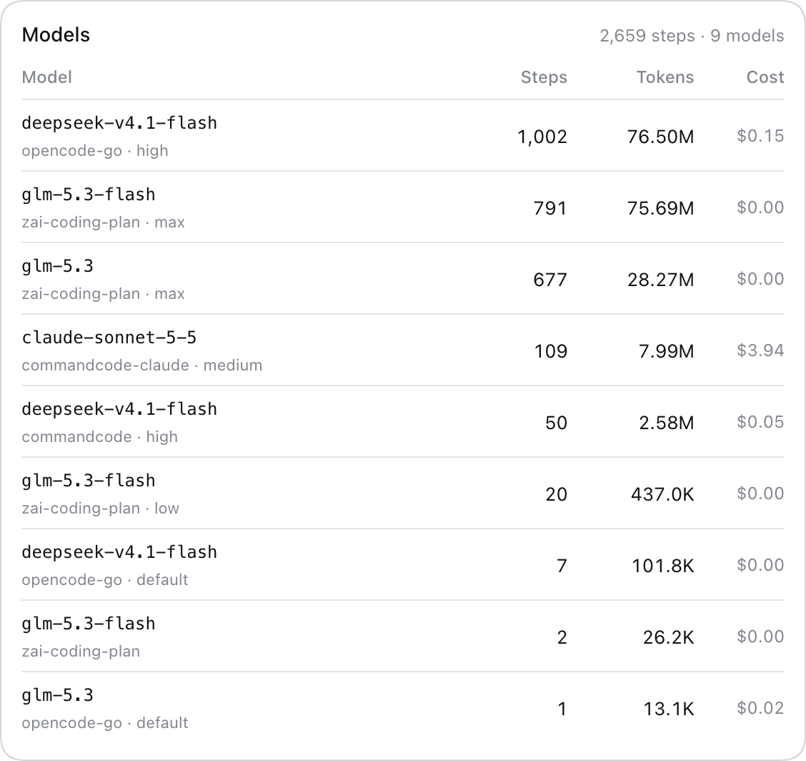

# opencode usage (PNC)

A [DeepSeek Harness](https://github.com/deepseek-ai/deepseek-harness) plugin bundle that shows
live [opencode](https://opencode.ai) usage in the Harness Web UI: sessions, prompts, tokens,
estimated cost, and per-tool reliability, read on demand from the local `opencode` CLI.





## What you get

- **Settings → opencode usage** page with range chips (7 / 30 / 90 days, all time), four stat
  tiles, a token breakdown bar, a per-model usage table, and a tool-reliability table.
- **Live data** from `opencode stats --json --models`: sessions, tokens, cost, and usage per
  provider/model. Each range is cached for 30 seconds, and the Refresh button forces a fresh
  read.
- **No extra service and no secrets**: the Harness Host runs the CLI locally; the page fetches
  one authenticated JSON endpoint.
- English and German page copy, host theme tokens (light and dark), and an original icon.

## Requirements

- DeepSeek Harness 0.2.x with the Web UI (desktop app or `dsh web`).
- `opencode` on the Host, with the local state that `opencode stats` reads. The Host resolves
  the binary at `$OPENCODE_BIN`, `/opt/homebrew/bin/opencode`, `/usr/local/bin/opencode`,
  `~/.local/bin/opencode`, `/usr/bin/opencode`, then `PATH`.

## Install

The package is a local bundle (`@local/opencode-usage`), not a registry package.

```sh
git clone https://github.com/webmanufaktur/dsh-opencode-usage-plugin.git
```

Install the checkout as a profile bundle: in the Harness, ask the agent to *install the bundle
at `/absolute/path/dsh-opencode-usage-plugin`* — `plugin_manager install_bundle` links the
directory and enables it. The row id is `opencode-usage`.

Then open **Settings → opencode usage**. Because the package is link-installed, edits in the
checkout apply without reinstalling; restart the Harness to reload the Host half.

## How it works

### Host half — `index.js`

Registers one authenticated exact-Fetch route through `ctx.connection.fetch`:

```
GET /api/opencode.usage?range=7|30|90|all[&fresh=1]
```

- Runs `opencode stats --json --models` (`--days <n>` or `--all`) and projects the payload into
  small display values: sessions, subagents, prompts, steps, token totals, cost, per-model rows
  (provider, model, variant, steps, tokens, cost), tool calls and the top 8 tools by call count.
- Sorts the model rows by steps and keeps the top 10; `modelCount` carries the full count.
- Caches each range for 30 seconds; `fresh=1` bypasses the cache (used by Refresh).
- Returns `{ ok: false, error }` with status 400 for an unknown range and 502 when the CLI
  fails or is missing.

The route lives inside the browser-authentication fence, so only the owner's page can read it.

### Client half — `client.js`

Registers a `settings.section` entry ("opencode usage") and renders the page with host theme
tokens. It fetches the route document-relative (`api/opencode.usage`), so the existing browser
cookie authenticates the request. Copy comes from locale dictionaries in English and German.

### Layout

| Path | Purpose |
| --- | --- |
| `index.js` | Host half: the route, CLI invocation, cache, projection |
| `client.js` | Client half: Settings page, dictionaries, styles |
| `cordis.patch.yml` | Bundle patch inserting the `opencode-usage` row |
| `locale/en.json`, `locale/de.json` | Plugin Manager title and description |
| `icon.svg` | Plugin icon |
| `docs/preview.png` | Screenshot of the rendered page |

## Development

No build step and no dependencies. Check syntax with `node --check index.js client.js`. The
running Harness picks up client changes through HMR; restart it after changing `index.js`.

## Tech Stack

- JavaScript (ESM), plain browser module, no build step
- DeepSeek Harness plugin bundle (Cordis loader, `dsh.client` web module)
- Host: Node.js, authenticated exact-Fetch route, `node:child_process`
- Client: React from the Harness module table, host `--dsw-alias-*` theme tokens
- Data: local `opencode` CLI (`opencode stats --json`)

## Domains

| Env  | URL |
| ---- | --- |
| prod | — (local Harness plugin; no hosted endpoint) |
| dev  | — (same checkout, link-installed in the `desktop` profile) |

## Client

Internal developer tooling by Alexander Abelt (webmanufaktur). It runs inside the local
DeepSeek Harness and has no external client.
